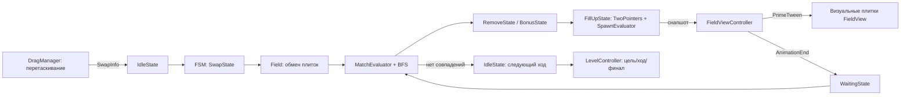

# Match-3 Core

Игра в жанре match-3 с полностью собственным ядром симуляции на C#: детектом совпадений,
гравитацией, спавном плиток, бонусами, блокерами и конечным автоматом игрового потока.
Стороннего match-3-фреймворка, ECS и готовых систем ИИ проект не использует — важные правила
описаны в ассетах `ScriptableObject` и редактируются в инспекторе Unity.

| Параметр | Значение |
|---|---|
| Движок | Unity `6000.4.5f1` |
| Render pipeline | URP `17.4.0` |
| Платформы | Desktop (Build-desktop), WebGL (есть шаблон в `Assets/WebGLTemplates`) |
| Сцены в сборке | `MainMenuScene`, `LevelScene` |
| Язык | C# (весь код рантайма в `Assembly-CSharp`) |
| Состояние | Активный прототип; автотесты отсутствуют |

---

## Оглавление

1. [О проекте](#1-о-проекте)
2. [Возможности](#2-возможности)
3. [Быстрый старт](#3-быстрый-старт)
4. [Управление](#4-управление)
5. [Технологии и зависимости](#5-технологии-и-зависимости)
6. [Архитектура](#6-архитектура)
   - [6.1. Слои](#61-слои)
   - [6.2. Взаимодействие слоёв](#62-взаимодействие-слоёв)
   - [6.3. Поток данных](#63-поток-данных)
7. [Структура проекта](#7-структура-проекта)
8. [Игровой цикл и конечный автомат](#8-игровой-цикл-и-конечный-автомат)
9. [Ключевые системы](#9-ключевые-системы)
   - [9.1. Поле и идентичность плиток](#91-поле-и-идентичность-плиток)
   - [9.2. Детект совпадений](#92-детект-совпадений)
   - [9.3. Спавн и сложность](#93-спавн-и-сложность)
   - [9.4. Бонусы](#94-бонусы)
   - [9.5. Блокеры и гравитация](#95-блокеры-и-гравитация)
   - [9.6. Визуальная синхронизация](#96-визуальная-синхронизация)
   - [9.7. Ввод](#97-ввод)
   - [9.8. UI, звук и прогресс](#98-ui-звук-и-прогресс)
10. [Настройка контента](#10-настройка-контента)
11. [Сборка](#11-сборка)
12. [Производительность](#12-производительность)
13. [Тестирование](#13-тестирование)
14. [Известные ограничения](#14-известные-ограничения)
15. [Участие в разработке](#15-участие-в-разработке)
16. [Лицензия](#16-лицензия)

---

## 1. О проекте

Проект представляет собой законченный игровой цикл match-3: игрок меняет две соседние
плитки местами, движок находит группы, удаляет их, опускает верхние плитки вниз, заполняет
пустоты и повторяет оценку до стабилизации поля. Каскады, бонусы и блокеры добавляют
стратегический слой.

Авторитетное состояние поля хранится в `Field` — двумерном массиве `LogicalTile?[,]`.
Клетки идентифицируются по `Guid`, а не по индексу: упавшая плитка сохраняет identity,
поэтому слой представления распознаёт её как перемещение, а не как удаление и создание.
Индексная конвенция: `Vector2Int.x` — строка, `Vector2Int.y` — столбец.

Переходы между фазами хода описаны данными в ассете `FieldStates`, а не захардкожены в
коде. Это позволяет менять граф состояний из инспектора.

---

## 2. Возможности

- **Собственный детектор совпадений** — BFS/flood-fill по 4 соседям с data-driven
  предикатами; порог группы — 3 плитки.
- **Три типа плиток**: обычные (6 цветов), бонусы (3 вида) и блокеры (3 вида).
- **Бонусы**: площадь (`Bomb` по расстоянию Чебышёва), горизонтальная и вертикальная
  линии; цепная детонация транзитивно через всю сетку.
- **Блокеры**: прикреплённые (`Box`, `Frozen`) разбивают гравитацию на сегменты; `Safe`
  падает за поле; правила удаления настраиваются ассетами.
- **Каскады** — повторная оценка после каждого заполнения; вес цвета, который создал бы
  совпадение, снижается по мере роста номера каскада.
- **Цели уровня** — список «нитей» (`RopeGoal`) с прогрессом по типам плиток и счётчик
  ходов; победа/поражение и конверсия неиспользованных ходов в бонусы.
- **Плавные анимации** на PrimeTween: появление, падение со «желейным» отскоком,
  взрывы бонусов и блокеров, волна по строкам.
- **Сохранение прогресса и реклама** через SDK Yandex Games (`YG2.saves`,
  interstitial), настройки музыки/звука через `PlayerPrefs`.
- **Производительность**: пул плиток и пулы коллекций `UnityEngine.Pool`, кэши
  ScriptableObject-ов, `MaterialPropertyBlock`, отсутствие `Update()` в игровом пути.

---

## 3. Быстрый старт

1. Установите Unity **6000.4.5f1** (редактор версии зафиксирован в
   `ProjectSettings/ProjectVersion.txt`).
2. Клонируйте репозиторий и откройте папку `D:\Unity\Match3` как проект Unity.
   Пакеты подтянутся из `Packages/manifest.json`; PrimeTween подключён локальным
   `file:`-пакетом из `Assets/Plugins/PrimeTween/internal`.
3. Дождитесь импорта ассетов. В `Build Settings` уже включены две сцены:
   - `Assets/Game/Scenes/MainMenuScene.unity` — точка входа (меню);
   - `Assets/Game/Scenes/LevelScene.unity` — игровой уровень.
4. Откройте `MainMenuScene` и нажмите **Play**. Выберите уровень в меню — сцена
   загрузится через `LoadingController` с экраном загрузки.
5. Текущий уровень берётся из `YG2.saves.currentLevelId`, поэтому при запуске в
   редакторе без SDK проверьте это значение, если уровень не открывается.

> Если SDK Yandex Games недоступен в редакторе, игровая логика всё равно работает;
> привязка к нему есть в меню, контроллере уровня и панелях завершения.

---

## 4. Управление

| Действие | Ввод |
|---|---|
| Обмен плиток | Нажмите на плитку и перетащите её на соседнюю (мышь или касание) |
| Направление | Ось фиксируется по доминирующему `dx`/`dy`; смещение ограничено одной клеткой |
| Отмена | Верните курсор дальше чем на 1.2 единицы от цели — плитка вернётся на место |
| Блокеры | Нельзя выбрать ни как источник, ни как цель перетаскивания |
| Блокировка ввода | Ввод отключается на время каскада и анимации (`GameEvent.Input` с флагом `bool`) |

Дополнительно в меню доступны окно выбора уровня, настройки (переключатели music/sound)
и подтверждение выхода; на панелях завершения при выходе показывается interstitial-реклама.

---

## 5. Технологии и зависимости

| Компонент | Версия / источник | Назначение |
|---|---|---|
| Unity | `6000.4.5f1` | Движок |
| URP | `17.4.0` | 2D-рендеринг, шейдеры и шейдер-графы |
| Input System | `1.19.0` | `InputActionReference`, Pointer, raycast по 2D-коллайдерам |
| PrimeTween | локальный `file:`-пакет | `Sequence` / `Chain` / `Group` для анимаций |
| `UnityEngine.Pool` | встроенный API | Пулы объектов и временных коллекций |
| uGUI + TextMesh Pro | встроенный пакет | Весь UI и текст |
| PluginYourGames (Yandex Games) | `Assets/PluginYourGames` | Сохранения, interstitial-реклама |
| Event Bus | собственный `GameplayEventBus<T>` | Развязка модулей через строки-каналы |

Файлов `asmdef` нет: весь код компилируется в `Assembly-CSharp`. Тестовых сборок нет,
хотя пакет `com.unity.test-framework` подключён.

---

## 6. Архитектура

### 6.1. Слои

```text
┌──────────────────────────────────────────────────────────────────────┐
│ СЛОЙ ПРЕДСТАВЛЕНИЯ И ВВОДА (MonoBehaviour)                           │
│ DragManager · FieldViewController · FieldView · Tile · WoolController│
│ TaskListController · StepsController · SFX · панели и меню           │
└──────────────────────────────────────────────────────────────────────┘
                    ▲ снапшоты LogicalTile?[,]   │ SwapInfo / bool
                    │                            ▼
┌──────────────────────────────────────────────────────────────────────┐
│ СЛОЙ ОРКЕСТРАЦИИ (ScriptableObject-состояния)                        │
│ FiniteStateMachine · FieldStates · FieldBlackboard · GameState'ы     │
└──────────────────────────────────────────────────────────────────────┘
                    │ Switch(StateEvent) / Field
                    ▼
┌──────────────────────────────────────────────────────────────────────┐
│ СЛОЙ СИМУЛЯЦИИ (обычные C# классы и структуры)                       │
│ Field · MatchEvaluator · SpawnEvaluator · BFS · TwoPointers · Euclide │
└──────────────────────────────────────────────────────────────────────┘
                    ▲ правила и параметры
                    │
┌──────────────────────────────────────────────────────────────────────┐
│ СЛОЙ ДАННЫХ (ассеты ScriptableObject)                                │
│ LevelSettings · Levels · MatchRules · SpawnRules · BlockerDestroyRules│
│ TileTypeData · Events · Sounds · FieldStates · ScoreData · SessionData│
└──────────────────────────────────────────────────────────────────────┘
```

Симуляция не хранит ссылок на Unity-объекты сцены и не трогает визуальные плитки;
представление не изменяет `Field`. Исключение — наследование `Field` и состояний от
`MonoBehaviour` / `ScriptableObject` ради сериализации в инспекторе.

### 6.2. Взаимодействие слоёв

Есть два канала связи:

1. **Команды конечного автомата** — `FiniteStateMachine.Switch(StateEvent)` ищет
   следующий `GameState` в таблице `FieldStates` и вызывает `Enter`. Общие данные хода
   живут в `FieldBlackboard`.
2. **Событийная шина** — `GameplayEventBus<T>`: статический `Dictionary<string, Action<T>>`
   с `Register` / `Unregister` / `Trigger`. Имена каналов не захардкожены: они
   резолвятся через `Events.GetBusName(GameEvent)` из ассета `Events`.

Основные каналы:

| Канал | Полезная нагрузка | Кто публикует | Кто слушает |
|---|---|---|---|
| `Input` | `SwapInfo` / `bool` | `DragManager`, состояния FSM | `IdleState`, `DragManager` |
| `Animation` | `LogicalTile?[,]` | `LoadingState`, `RemoveState`, `FillUpState`, `SwapState`, `FinalState` | `FieldViewController` |
| `AnimationSync` | `LogicalTile?[,]` | `SwapState` | `FieldViewController` |
| `AnimationEnd` | `bool` | `FieldViewController` | `WaitingState` |
| `ShaderImpact`, `Score` | `(prev, cur)` | `RemoveState` | `WoolController`, `TaskListController` |
| `ShaderDestroyTile` | `bool` | `FieldViewController` | `WoolController`, `TaskListController` |
| `FieldSettled` | `int` / `bool` | `IdleState`, `LevelController` | `LevelController`, `IdleState` |
| `StepIncreased` | `int` | `IdleState` | `StepsController` |
| `PlaySFX` | `GameSound` | `SwapState`, `FieldViewController` | `GameplaySFXManager` |
| `Final` | `bool` | `FinalState` | `LevelController` |
| `SettingChanged` | `bool` | `ToggleManager` | `BackgroundMusicController` |

### 6.3. Поток данных



После каждой мутации `Field` состояние публикует глубокую копию поля (`ToSnapshot()`).
`FieldViewController` сравнивает предыдущий и новый снапшоты по `Guid` и строит список
действий `Spawn` / `Move` / `Destroy`.

---

## 7. Структура проекта

```text
D:\Unity\Match3\
├── Assets\
│   ├── Game\                          ← весь собственный код и контент
│   │   ├── Components\                ← MonoBehaviour: поле, ввод, UI, камера, FSM-хост
│   │   │   ├── FSM\                   ← FiniteStateMachine, FieldBlackboard
│   │   │   └── MainMenuScene\         ← меню, выбор уровня, настройки, загрузка
│   │   ├── ScriptableObjects\         ← данные и алгоритмы
│   │   │   ├── States\                ← GameState-подклассы и FieldStates
│   │   │   ├── Levels\                ← LevelSettings, Level*.asset, Levels.asset
│   │   │   ├── TileMatchRules\        ← предикаты совпадений + MatchRules
│   │   │   ├── TileSpawnRules\        ← сопоставление формы группы с бонусом
│   │   │   ├── BlockerDestroyRules\   ← правила уничтожения блокеров
│   │   │   ├── Tiles\                 ← TileKind → TileDataBase (цвета, спрайты)
│   │   │   ├── Events\                ← enum GameEvent и маппер имён шин
│   │   │   ├── Sounds\                ← enum GameSound и маппер клипов
│   │   │   └── Session\               ← ScoreData, SessionData
│   │   ├── Bus\                       ← GameplayEventBus<T>
│   │   ├── Drawers\                   ← атрибут [Req] и подсветка незаполненных полей
│   │   ├── Editor\                    ← TileGeometryEditor (авторинг форм бонусов)
│   │   ├── Scenes\                    ← MainMenuScene.unity, LevelScene.unity
│   │   ├── Prefabs\, UI\, Animations\, Sounds\, Fonts\, Materials\
│   │   ├── Shaders\                   ← URP-шейдеры и shader graph
│   │   └── Types\                     ← дополнительные типы данных
│   ├── Plugins\PrimeTween\            ← локальный пакет твинов и демо
│   ├── PluginYourGames\               ← SDK Yandex Games
│   ├── Settings\, Resources\, Scenes\, TextMesh Pro\, UI Toolkit\, WebGLTemplates\
│   └── InputSystem_Actions.inputactions
├── Packages\manifest.json             ← зависимости пакетов
├── ProjectSettings\                   ← настройки проекта и Build Settings
├── Build-desktop\                     ← вывод сборки (не исходники)
├── Library\, Logs\, MemoryCaptures\, ProfilerCaptures\  ← генерируемые данные
└── README.md
```

### Ключевые скрипты

| Файл (`Assets/Game/...`) | Ответственность |
|---|---|
| `Components/Field.cs` | Авторитетное поле, `LogicalTile`, операции по позиции и `Guid` |
| `Components/FieldView.cs` | Пул визуальных плиток, реестр `Guid → Tile`, сетка → мир |
| `Components/FieldViewController.cs` | Diff снапшотов, очередь и последовательности анимаций |
| `Components/DragManager.cs` | Ввод, raycast, оси перетаскивания, публикация `SwapInfo` |
| `Components/LevelController.cs` | Жизненный цикл уровня, UI-панели, условия завершения |
| `Components/FSM/*` | Машина состояний и общий «блекборд» хода |
| `ScriptableObjects/BFS.cs` | Заливка по 4 соседям с правилами из ассетов |
| `ScriptableObjects/MatchEvaluator.cs` | Полный скан, проба одной клетки, Area бонусов |
| `ScriptableObjects/SpawnEvaluator.cs` | Взвешенный выбор цвета и спавн бонусов |
| `ScriptableObjects/TwoPointers.cs` | Уплотнение столбца с учётом закреплённых блокеров |
| `ScriptableObjects/Euclide.cs` | Шаг для равномерной конверсии ходов в бонусы |
| `ScriptableObjects/States/*` | Состояния игрового цикла |
| `Bus/GameplayEventBus.cs` | Статическая шина событий |

---

## 8. Игровой цикл и конечный автомат

`FiniteStateMachine` хранит текущий `GameState`, `FieldBlackboard` и экземпляры
`MatchEvaluator` / `SpawnEvaluator`. Состояние — ассет `ScriptableObject` с единственным
методом `Enter(FiniteStateMachine)`; `Exit`/`Update` отсутствуют. Переход ищется в
двухуровневом словаре `FieldStates` по паре `(текущее состояние, StateEvent)`.

| Состояние | Роль в цикле |
|---|---|
| `LoadingState` | Первичное заполнение поля (`difficulty = 1000`) и расстановка блокеров |
| `IdleState` | Ожидание ввода, счётчик ходов, запрос на проверку конца уровня |
| `SwapState` | Обмен по `SourceId`/`DestId`; бонусы → детонация, иначе → оценка |
| `SwapBackState` | Отмена обмена, если плитки не найдены |
| `Evaluation` | Поиск групп, сопоставление форм со спавном бонусов |
| `BonusState` | Очередь цепной детонации бонусов |
| `RemoveState` | Удаление блокеров и совпавших плиток, публикация снапшота и очков |
| `FillUpState` | Спавн бонусов, гравитация, удаление `Safe`-блокеров, добирание плиток |
| `WaitingState` | Мост от `AnimationEnd` обратно в FSM |
| `FinalState` | Победа/поражение, конверсия ходов, детонация всех бонусов на поле |

Типичная последовательность事件:

```text
Loading → Idle → Swap → Evaluation
                         ├─ нет групп → SwapBack → Waiting → Idle
                         └─ есть группы → Remove → Waiting → FillUp → Waiting
                                                               └→ Evaluation (каскад)
                                                                   └→ Idle → ... → Final
```

`FieldBlackboard` переносит между состояниями `SourceDest`, `CurrentMatches`,
`CurrentBonuses`, `CascadeIteration`, `Step` / `MaxSteps`, `IsWin`, `BonusesToActivate` и
список блокеров. Очистка списков совпадений выполняется в `Evaluation`; сброс каскада
привязан к номеру итерации.

---

## 9. Ключевые системы

### 9.1. Поле и идентичность плиток

`Field` — плотный массив `LogicalTile?[,]` размером `Rows × Columns`. `Nullable<T>`
позволяет различать пустую клетку и валидный `default(TileKind)`. Идентичность плитки —
`Guid` (`Field.GenerateUniqueId()`), позиция не является идентичностью. Позиции можно
получить напрямую (`GetTileAt(Vector2Int)`) или построить кэш `Guid → Vector2Int` за
один проход (`ToPositionChache`), чтобы не сканировать поле на каждый запрос по `Id`.

`TileKind` — value-type с дискриминатором `TileKindType` (`Regular`, `Bonus`, `Blocker`).
`IsAnchored` (`BlockerType.Box || BlockerType.Frozen`) отмечает блокеры, которые не
участвуют в гравитации.

### 9.2. Детект совпадений

Это не классический подсчёт серий по строкам/столбцам, а BFS-заливка: обход всегда идёт
по четырём соседям, а форма «линия» задаётся правилом, сравнивающим клетку с **началом**
заливки (`source`), а не с текущей клеткой фронтира.

| Правило (`TileMatchRules/`) | Предикат |
|---|---|
| `TileCommonMatchRule` | Соседние обычные плитки одного `RegularType` |
| `TileBombMatchRule` | Расстояние Чебышёва от источника ≤ радиусу (квадратная область) |
| `TileHorizontalMatchRule` | Та же строка, что и источник |
| `TileVerticalBombMatchRule` | Тот же столбец, что и источник |

`MatchEvaluator.Evaluate` сканирует все клетки, арендует `bool[]`visited из `ArrayPool`,
запускает `BFS.Run` и сохраняет группы размером **> 2**. `MatchRules.BuildLookup()`
строит `Dictionary` type → правила, поэтому резолв на клетку — O(1). `AddBonusGroup`
применяет правила бонуса без порога размера (Area бомбы валидна и из одной клетки).

### 9.3. Спавн и сложность

`SpawnEvaluator.Evaluate` для каждой пустой клетки по очереди пробно вставляет каждый из
6 цветов и спрашивает `MatchEvaluator.EvaluateTile`, образовалось бы совпадение. Если да —
вес кандидата делится на `(1 + difficultModified)`; безопасные цвета остаются с весом `1`.
Выбор — взвешенный резервуарный отбор. Первичная загрузка передаёт `1000` (почти полное
подавление случайных совпадений), каскады передают `Blackboard.CascadeIteration`, то есть
чем длиннее каскад, тем меньше шанс нового случайного матча.

### 9.4. Бонусы

- **Типы**: `Bomb` (квадратная Area), `VerticalBomb`, `HorizontalBomb` (линии).
- **Создание**: `EvaluationState` превращает найденную группу в позиции и вызывает
  `SpawnEvaluator.EvaluateBonusSpawn`; `SpawnRules` ищет правило по размеру группы,
  поддерживается нормализация формы и повороты на 90/180/270°.
- **Активация**: если обмен затронул бонус, `BonusState` кладёт оба `Guid` в очередь и
  транзитивно добавляет в неё все бонусы, попавшие в Area — так работает цепная
  детонация.
- **Финал**: если ходы закончились, `FinalState` конвертирует оставшиеся ходы в бонусы
  (шаг из `Euclide.Run` распределяет их по полю) или взрывает все бонусы сразу.

### 9.5. Блокеры и гравитация

`BlockerDestroyRules` связывает `BlockerType` с правилом удаления:

| Правило | Условие |
|---|---|
| `BlockerAdjacentMatchRule` | Один из 4 соседей входит в текущие совпадения |
| `BlockerBottomRowRule` | Строка 0 (нижняя по соглашению индексов) |
| `BlockerIndestructibleRule` | Никогда |

`RemoveState` обрабатывает блокеры до очистки плиток; `FillUpState` — после гравитации.
Гравитация (`TwoPointers.Run`) вызывается один раз на столбец: закреплённые блокеры
разбивают столбец на сегменты, внутри каждого сегмента два указателя уплотняют плитки
вниз без аллокаций. Переходы `From → To` затем применяются как обмены в `Field`.

### 9.6. Визуальная синхронизация

`FieldView` владеет `ObjectPool<Tile>` (ёмкость 100 / максимум 1000) и словарём
`Guid → Tile`. `FieldViewController` получает снапшоты через шину `Animation`, ставит их в
очередь и для каждой пары `(prev, current)` строит:

- `Spawn` — новый `Guid`, бонус появляется на месте, обычная плитка — из строки `r + 1`;
- `Move` — тот же `Guid`, другая позиция (падение с squash-and-stretch);
- `Destroy` — плитка исчезла, выбор анимации зависит от типа (обычная / блокер / бонус).

Все твины компонуются в `PrimeTween.Sequence`; задержка строки равна `rowIndex * 0.05f`.
По завершении публикуется `AnimationEnd`, и очередь переходит к следующему снапшоту.
Визуальная часть на всём протяжении каскада не мутирует симуляцию.

### 9.7. Ввод

`DragManager` подписан на `InputAction` из `Assets/Game/DragNDrop.inputactions` и не имеет
`Update()`. Нажатие — `Physics2D.Raycast` по коллайдеру `Tile`, перемещение фиксируется
по доминирующей оси и ограничено ±1 клеткой, отпускание публикует `SwapInfo`.
Канал `Input` с `bool` включает/выключает действия, чтобы поле нельзя было трогать во
время каскада.

### 9.8. UI, звук и прогресс

- `TaskListController` создаёт виджеты `GoalController` по `RopeGoal`, считает
  уничтоженные типы и сообщает о выполнении целей.
- `StepsController` / `StepsUnitController` отображают remaining ходы (`StepIncreased`).
- `WinPanelController` / `LosePanelController` / `EndOfLevelsController` управляют
  завершением, увеличивают `currentLevelId` и записывают прогресс через `YG2.SaveProgress()`.
- `SuccessNotificationController` показывает уведомление перед финальной панелью.
- `GameplaySFXManager` проигрывает `GameSound` → `AudioClip` из ассета `Sounds`;
  `BackgroundMusicController` читает флаг `Music` из `PlayerPrefs` и реагирует на
  `SettingChanged` от `ToggleManager`.

---

## 10. Настройка контента

Правила и контент редактируются в инспекторе — код менять не нужно:

| Ассет | Menu item | Что настраивает |
|---|---|---|
| `LevelSettings` | `Levels/New Level` | `levelNumber`, `Rows`, `Columns`, `Steps`, `Difficulty`, списки плиток, фон, `RopeGoal`, `Blockers` |
| `Levels` | `Scriptable Objects/Levels` | Реестр уровней: список `LevelSettings`, доступ по `levelNumber` |
| `FieldStates` | `Scriptable Objects/FieldStates` | Таблица переходов `(GameState, StateEvent) → GameState` |
| `MatchRules` | — | `RegularType`/`BonusType` → список правил совпадений |
| `SpawnRules` | — | Размер группы → правила формы бонуса |
| `BlockerDestroyRules` | — | `BlockerType` → правило удаления |
| `TileTypeData` | — | Тип плитки → цвета и спрайт (`TileDataBase`) |
| `Events` | `EventBus/Mapper` | `GameEvent` → строковое имя шины |
| `Sounds` | — | `GameSound` → `AudioClip` |

Чтобы добавить уровень: создайте `LevelSettings`, заполните параметры, добавьте ассет в
список `Levels.asset`, убедитесь, что `levelNumber` совпадает с сохраняемым
`YG2.saves.currentLevelId`. Формы бонусов рисуются в редакторе `TileGeometryEditor`
(`Assets/Game/Editor`).

---

## 11. Сборка

1. Откройте `File > Build Profiles` (или `Build Settings`) — сцены `MainMenuScene` и
   `LevelScene` уже включены в порядке `0` и `1`.
2. Для Windows выберите целевую платформу и соберите в `Build-desktop/` (папка уже
   присутствует в репозитории как output-директория).
3. Для WebGL используйте шаблон из `Assets/WebGLTemplates`: укажите его в
   `Project Settings > Player > Resolution and Presentation > WebGL Template`.
4. Символы условной компиляции и версия редактора фиксируются в `ProjectSettings/`.

> `Library\`, `Logs\`, `MemoryCaptures\`, `ProfilerCaptures\` и `Build-desktop\` —
> генерируемые каталоги, не исходный код.

---

## 12. Производительность

- Пул визуальных плиток исключает `Instantiate`/`Destroy` после прогрева.
- Временные списки, словари, хэшсеты и массивы берутся из `UnityEngine.Pool` /
  `ArrayPool.Shared` и возвращаются в конце хода.
- `TileSnapshot`, `BonusSource`, `AlgoritmContext` — структуры; предикаты правил
  принимают аргументы по `in`, копий в горячем цикле нет.
- Таблицы `MatchRules`, `SpawnRules`, `TileTypeData`, `BlockerDestroyRules`,
  `FieldStates`, `Events`, `Sounds`, `Levels` строятся один раз в `OnEnable`.
- `Tile` переиспользует `MaterialPropertyBlock` и кэшированные `Shader.PropertyToID`.
- Ни один `MonoBehaviour` в игровом пути не использует `Update()`: прогресс идёт от
  событий шины и колбэков завершения твинов.

---

## 13. Тестирование

Автотестов в репозитории нет: нет тестовых сборок, каталогов `Tests` и `asmdef`.
Пакет `com.unity.test-framework` подключён, чистые алгоритмы (`BFS`, `TwoPointers`,
`MatchEvaluator`, `SpawnEvaluator`, `Euclide`) могут быть покрыты юнит-тестами после
добавления тестовых assembly definition.

Проверка вручную: открыть `MainMenuScene`, выбрать уровень, убедиться в обмене плиток,
каскадах, срабатывании бонусов, работе блокеров и появлении финальной панели.

---

## 14. Известные ограничения

- Нет assembly definition: весь код попадает в `Assembly-CSharp`, границы между слоями
  поддерживаются соглашениями, а не компилятором.
- Нет автотестов (см. раздел 13).
- Имена шин задаются строками в ассете `Events`; опечатка в имени приведёт к молчаливому
  отсутствию связи между издателем и подписчиком.
- Статическая шина событий не очищается при перезагрузке домена; обработчики снимаются в
  `OnDisable` компонентов.
- Зависимость от SDK Yandex Games (`YG2`) в меню и панелях; в автономной сборке эти
  вызовы нужно учитывать.
- Отсутствует `IsInBounds`-проверка в прямых аксессорах `Field`; вызывающие обязаны
  передавать корректные координаты.

> Этот раздел — фактические характеристики текущего кода, а не список правок.

---

## 15. Участие в разработке

- Собственный геймплейный код лежит в `Assets/Game`; сторонние пакеты — в
  `Assets/Plugins` и `Assets/PluginYourGames`, их лучше не изменять напрямую.
- Новые правила добавляйте как подклассы `TileMatchRuleBase`, `TileSpawnRuleBase` или
  `BlockerDestroyRuleBase` и регистрируйте ассетом, а не хардкодом.
- Состояния добавляйте через подкласс `GameState` и новую строку в `FieldStates`.
- Для сериализуемых ссылок используйте атрибут `[Req]` — инспектор подсветит незаполненные
  поля.
- Перед коммитом проверяйте, что `.meta`-файлы новых ассетов попали в репозиторий.

---

## 16. Лицензия

Лицензия в репозитории не указана. Если вы планируете использовать проект вне этого
репозитория, уточните условия у владельца.
